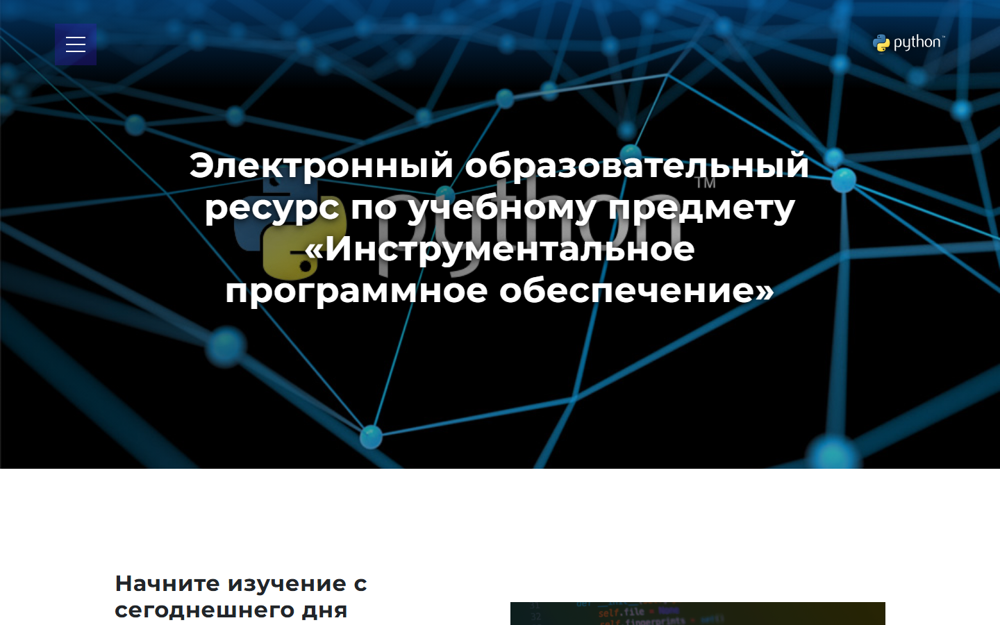

# Электронный образовательный ресурс по Python

Учебный сайт по предмету «Инструментальное программное обеспечение»: курс языка Python с лекциями, лабораторными работами, презентациями и тестами.

**Открыть:** https://thefulum.github.io/python-complex/



## О проекте

Ресурс собирает в одном месте все материалы учебного предмета: студент проходит курс по разделам, читает лекции, выполняет лабораторные работы, смотрит презентации и проверяет себя тестами. Сайт работает без серверной части и открывается в любом браузере, в том числе с телефона.

## Содержание курса

- Введение
- Синтаксис и основные типы данных Python
- Структурированные типы данных
- Объектно-ориентированное программирование в Python
- Взаимодействие с сетью интернет: клиент-серверные приложения и сокеты
- Фреймворки и библиотеки языка Python
- Обязательные контрольные работы (ОКР 1 и ОКР 2)

## Возможности

- Около 190 страниц учебных материалов, разбитых по разделам.
- Для каждого раздела: лекции, лабораторные работы, презентации и тесты.
- Методические материалы для скачивания.
- Адаптивная вёрстка, меню разделов и слайдер на главной странице.

## Технологии

- HTML, CSS, JavaScript
- Bootstrap 4, jQuery, Owl Carousel, LineIcons
- GitHub Pages для публикации

## Структура

```
index.html        главная страница
Introduction/     введение
chapter_1 … 5/    разделы курса: лекции, лабораторные, презентации, тесты
OKR_1, OKR_2/     контрольные работы
resourse/         методические материалы
css/, img/        стили и изображения
```

